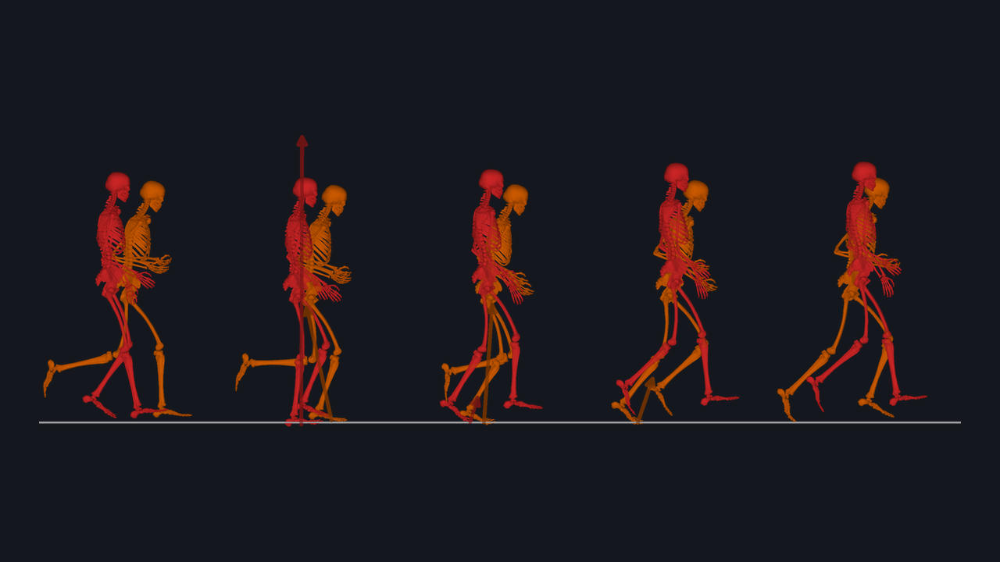

# 3d_simulations



**Can a 3D gait be predicted, without any tracking data, from a task (speed), a cost and a learned prior over plausible
states?** This project runs the BiomechPriorVAE paper pipeline with `biosym`: BioMAC's SIPP runmad model (33 DOF, 92
muscles, 10 arm torque actuators, 12 contact spheres) gets a random standing pose, then half-cycle walking or running at
a set speed, many random seeds per speed. The objectives are the Bhargava cost of transport, the learned state prior,
arm effort and a heel-strike variance penalty. The results are compared with the paper's reference data and baselines
(PredSim, GaitDynamics, GaitEncoder, ...) in the biosym versions of the paper's Figures 2, 3 and 4
(`results/figure*_biosym.png`).

## Related work

- Paper: BiomechPriorVAE, <https://doi.org/10.48550/arXiv.2610.08506>
- Simulation repository of the paper (MATLAB, BioMAC-Sim-Toolbox pipeline): <https://github.com/gambimar/BiomechPriorVAE>
- Analysis, figures and website of the paper: <https://github.com/gambimar/BiomechPriorVAE-visuals>; the reference data and
  baselines in `data/` come from there (`scripts/extract_paper_data.py`), the paper's figures 2, 3 and 4 are reproduced
  with biosym solutions in `scripts/plot_figure*.py`
- Result data of the paper: <https://doi.org/10.5281/zenodo.23207926>
- Simulation toolbox the model, muscles and cost follow: [BioMAC-Sim-Toolbox](https://github.com/mad-lab-fau/BioMAC-Sim-Toolbox)
- biosym, the optimal control framework used here: <https://github.com/biomac-group/biosym>

## Install

The project has no `pyproject.toml` of its own; it needs a `biosym` that contains the standard model's features (the
toolbox muscle `Gait3dMuscle`, implicit contact, `biosym.utils.state_prior`, `biosym-view`), i.e. the current `biosym`
checkout (0.2.0 development) and not the 0.1.12 release on PyPI. The scripts `chdir` into the project folder.

```bash
uv venv && source .venv/bin/activate
uv pip install -e /path/to/biosym[dashboard]      # a checkout of https://github.com/biomac-group/biosym
```

IPOPT with a fast linear solver (HSL `ma57`/`ma97`) is recommended; `--linear-solver mumps` works without HSL but is slower.

## Quickstart

One simulation:

```bash
python run.py 1.2                              # walking at 1.2 m/s, metabolic cost, seed 1 (standing first, if needed)
python run.py                                  # self-chosen speed
python run.py 4.5 --objective effort --seed 3  # running at 4.5 m/s with the muscle effort objective
python run.py --muscle_weakness 50             # hip abductors (both legs) at 50 % strength
python run.py 4.5 --objective effort --contact_stiffness 4 --contact_damping 0
python run.py --help                           # all options (nodes, solver, iteration limit, weights, logging, ...)
```

The result is `results/<name>/v<speed>/seed<k>.pkl` (`<name>`: `walking`, `effort`, plus the changes, e.g.
`effort_weak50_k4_c0`). Several seeds and speeds, and the pieces separately:

```bash
python scripts/paper_standing.py 1 2 3                    # random standing poses -> results/standing/seed<k>.pkl
python scripts/paper_walking.py 1.33 --n-converged 3      # walking at 1.33 m/s, seeded from the standing results
python scripts/view_solution.py results/walking/v1.33/seed1.pkl --cycles 3   # or: biosym-view <pkl> --cycles 3
```

The first run compiles the model (several minutes, cached afterwards); a walking solve is a long IPOPT run. The
reproduction of a paper figure from the shipped results does not need a solve, e.g. `python scripts/plot_figure1.py`.

## Layout


```
configs/    standing_paper.yaml, walking.yaml        templates; the pipeline scripts write per-run copies
models/     original/ (source .osim), sipp_runmad/   the standard model (sipp_runmad.yaml)
data/       reference/, baselines/                   walking/running reference and the baselines of Figure 1
run.py      one simulation (speed, seed, objective, muscle weakness, contact stiffness / damping)
scripts/    paper_*.py, extract_*.py, plot_figure*.py, make_sipp_model.py, cleanup_project.py
results/    standing/seed<k>.pkl                     standing results, one per seed
            walking/v<speed>/seed<k>.pkl             walking results; summary_<tag>.csv, _config_<tag>.yaml,
                                                     trials.npz (extract_biosym_trials.py) in the same folder
            figure1_biosym.png / .pdf
logs/       walking/                                 logs and resource usage of the workstation sweep
```

## Model

`models/sipp_runmad/sipp_runmad.yaml`: the SIPP runmad model with the BioMAC-Sim-Toolbox muscle (92 muscles,
`Gait3dMuscle`, muscle paths fitted by biosym from the `.osim` on the first build, about 20 s, cached), 10 arm torque
actuators (control in [-5, 5], optimal force 10 N m), the 12 contact spheres with the Hunt-Crossley contact law and
implicit contact forces (`contact_implicit.xml`, instantaneous contact velocity), the toolbox passive joint model and
the toe spring of Falisse et al. 2022 (mtp 25 N m/rad, 2 N m s/rad, no range wall). One model is used for standing,
walking and running.
Built from `models/original/` by `scripts/make_sipp_model.py`.


## Relation to biosym

Uses `biosym.ocp.collocation`, the OpenSim model import (`transform_fit: toolbox`), `Gait3dMuscle`, implicit Hunt-Crossley contact, the objectives `cot_term`/`state_prior`/`heelstrike_variance`
and the browser viewer `biosym-view`. These are the 0.2.0 features of biosym, see its CHANGELOG.

## Results and data

`results/standing/seed<k>.pkl`, `results/walking/v<speed>/seed<k>.pkl`, `results/figure{1,3,4}_biosym.png/.pdf`;
reference data and baselines in `data/`; solver logs in `logs/`. Results are pickles of `Collocation.solve`.

## Cite

This project reproduces the pipeline of the BiomechPriorVAE paper with biosym; please cite the paper
(<https://doi.org/10.48550/arXiv.2610.08506>) and biosym. No separate citation of this project exists.
The Falisse et al. 2022 toe spring and the Fukuchi running data are cited in the model files and scripts.
